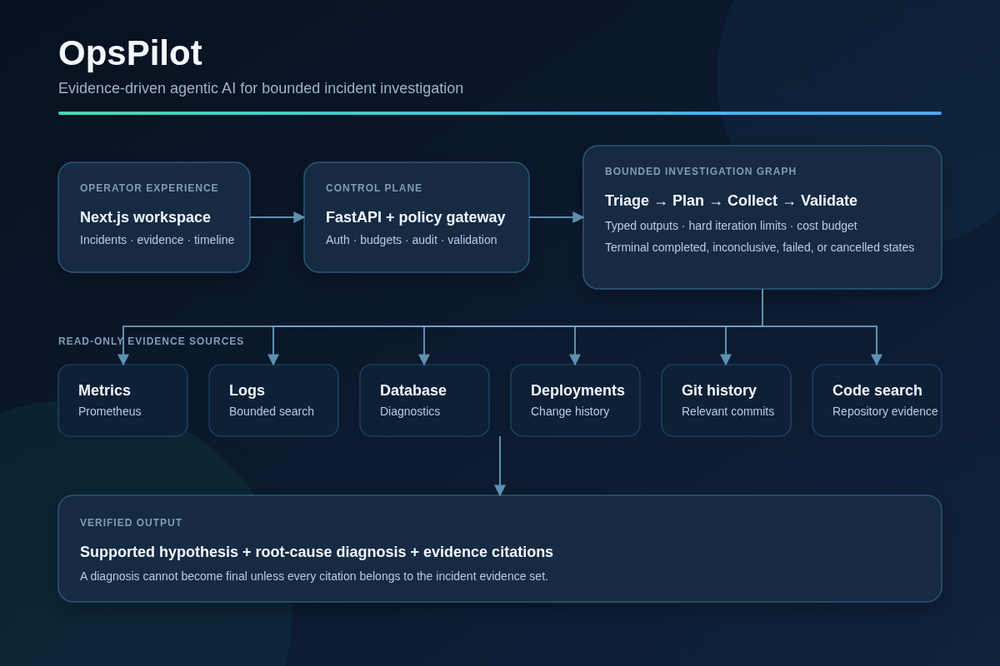

# OpsPilot — Phase 3

Evidence-driven incident response with a service registry, durable timelines, a
policy-controlled read-only tool gateway, and a bounded investigation graph. Phase 3
triages the first N+1-query scenario, collects six-source evidence, validates a
hypothesis, and produces a cited root-cause diagnosis. It deliberately stops before RAG,
patch generation, sandbox execution, approval, and remediation.



See the [portfolio case study](docs/PORTFOLIO_CASE_STUDY.md) for the problem, solution,
safety properties, and current implementation boundary.

## Run locally

Requires Docker Desktop or Docker Engine with Compose v2 or newer. Commands below use
Docker Desktop's `desktop-linux` context. Treat `opspilot/` as the repository root
(including its `.github/workflows/ci.yml` when creating a Git repository).

```bash
cd /home/ahmad/OpsPilot/opspilot
test -f .env || cp .env.example .env
# On a fresh checkout, set a unique URL-safe POSTGRES_PASSWORD.
# This workspace already has a generated local .env; preserve it.
docker --context desktop-linux compose up --build --wait
python3 scripts/smoke.py
```

Open http://localhost:3000, select **Create an account**, then sign in. New accounts are
viewers. To grant incident-write access to an existing local account:

```bash
docker --context desktop-linux compose exec api \
  python -m app.auth.cli set-role user@example.com engineer
```

Sign in again to refresh the role in the session. API documentation is available at
http://localhost:8000/api/v1/docs.

Swagger's **Try it out** requests are accepted from the configured `API_ORIGIN`.
Local defaults also trust the explicit `127.0.0.1` aliases on ports 3000 and 8000.
Additional origins must be deliberately configured with
`ADDITIONAL_TRUSTED_ORIGINS`; arbitrary browser origins remain blocked.

Health: `/api/v1/health`; readiness: `/api/v1/ready` (database schema + Redis).
Auth: `/api/v1/auth/register`, `/login`, `/logout`, `/me` under the auth prefix.
Incident resources: `/api/v1/services`, `/api/v1/incidents`,
`/api/v1/incidents/{id}/investigate`, `/cancel`, and `/events`.
Tool resources: `/api/v1/tools`, `/api/v1/incidents/{id}/tools/{tool}/execute`,
`/api/v1/incidents/{id}/tool-executions`, `/api/v1/incidents/{id}/evidence`, and
`/api/v1/evidence/{id}`. Phase 3 resources:
`/api/v1/incidents/{id}/hypotheses`, `/diagnosis`, `/model-executions`, and
`/hypotheses/{hypothesis_id}/validate`. Prometheus is available locally at
http://localhost:9090. Only engineers and admins can start or manually validate an
investigation. The worker runs the bounded graph and all diagnostic reads continue to
pass through the tool gateway.
For curl/API mutation requests, supply `Origin: http://localhost:3000`; retain cookies
with a cookie jar. Passwords must contain 12–128 characters.

`docker --context desktop-linux compose down` retains users and incidents. Redis sessions and
queued messages are ephemeral in this local configuration. After changing
an already initialized database password, update the database credentials explicitly;
changing the environment alone does not change PostgreSQL's stored password.

## Development and checks

To run the complete backend suite using the running Compose infrastructure:

```bash
docker --context desktop-linux compose run --build --rm test
docker --context desktop-linux compose exec api alembic check
python3 scripts/phase3_smoke.py
```

If Docker was just installed and group access has not reached your current session,
start a new login session, or run Docker commands through `sg docker -c '...'`.

Python 3.12+ and Node 22+ with pnpm 10.17.1:

```bash
cd backend
python3.12 -m venv .venv
. .venv/bin/activate
pip install -r requirements.lock
pip install --no-deps -e .
ruff check .
ruff format --check .
mypy app
pytest -q -m 'not integration'
# Against disposable PostgreSQL and Redis with DATABASE_URL and REDIS_URL set:
alembic upgrade head
alembic check
RUN_INTEGRATION=1 pytest -q -m integration
# Disposable test database only:
alembic downgrade base
alembic upgrade head
cd ../frontend
pnpm install --frozen-lockfile
pnpm lint
pnpm typecheck
pnpm build
```

For non-Docker backend development, export DATABASE_URL (postgresql+asyncpg://...),
REDIS_URL, FRONTEND_ORIGIN, API_ORIGIN, ADDITIONAL_TRUSTED_ORIGINS,
COOKIE_SECURE=false, and REGISTRATION_ENABLED=true. Run
`alembic upgrade head` then `uvicorn app.main:app --no-access-log --no-proxy-headers`.
Run `pnpm dev` in frontend; its API proxy defaults to localhost:8000.

## Created files and boundaries

- `backend/app/`: API, auth, incident/service domain, audit timeline, queue worker,
  evidence store, tool registry/gateway/adapters, explicit investigation graph,
  provider-neutral model router, core config/errors, async database, and JSON telemetry.
- `backend/alembic/`: user, incident-management, and tool-gateway migrations.
- `backend/tests/`: API, security, policy, adapter, graph, failure, budget, and
  real-service tests.
- `backend/tool-fixtures/`, `backend/tool-repository/`: fixed read-only demo sources.
- `backend/pyproject.toml`, `requirements.lock`, `requirements-runtime.lock`: tooling and pinned dependencies.
- `frontend/`: Next.js TypeScript App Router, authentication and incident workspace.
- `docker-compose.yml`, both Dockerfiles: local stack and ordered migration startup.
- `.github/workflows/ci.yml`: lint, types, tests, migration checks, builds, stack smoke.
- `scripts/smoke.py`: frontend proxy registration/login/logout acceptance check.
- `scripts/phase3_smoke.py`: live bounded-graph, hypothesis, citation, and N+1 diagnosis
  acceptance.
- `docs/specifications/`: preserved source specifications.
- `docs/adr/007-phase-zero-foundation.md`,
  `docs/adr/008-phase-one-incident-management.md`,
  `docs/adr/009-phase-two-tool-gateway.md`, and
  `docs/adr/010-phase-three-orchestrated-investigation.md`: architecture and safety
  decisions.
- `infra/prometheus/`: local metrics service configuration.
- `demo-app/`, `benchmarks/`: reserved directories.

See [Phase 3 validation](docs/PHASE_3_STATUS.md) for the delivered scope and exit
criteria. Phase 4 has not begun.
