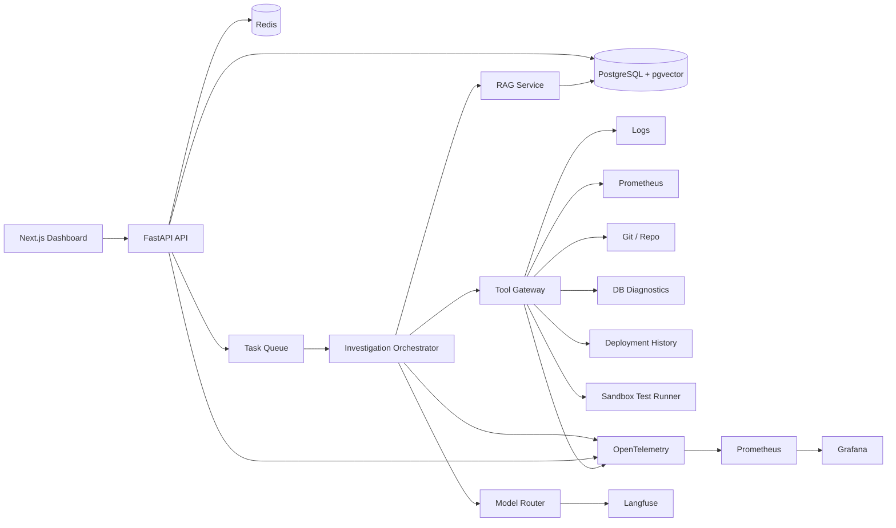
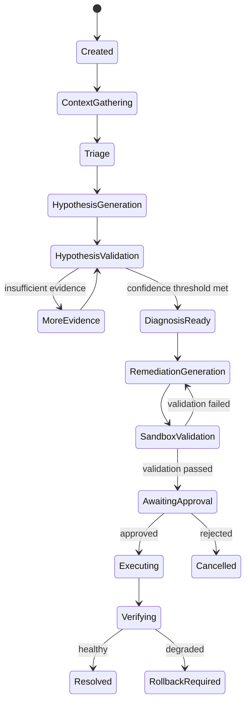

# System Architecture

## 1. High-Level Architecture



## 2. Architectural Style

Use a modular monolith for the application layer initially.

Do **not** create unnecessary microservices early.

Recommended deployable services:

- `api`
- `worker`
- `frontend`
- `postgres`
- `redis`
- `prometheus`
- `grafana`
- `langfuse` or hosted equivalent
- `demo-app`
- `demo-load-generator`

Within the Python backend, use strict module boundaries.

## 3. Backend Modules

```text
backend/
├── app/
│   ├── api/
│   ├── auth/
│   ├── incidents/
│   ├── investigations/
│   ├── agents/
│   ├── tools/
│   ├── rag/
│   ├── models/
│   ├── approvals/
│   ├── audit/
│   ├── evaluations/
│   ├── telemetry/
│   ├── providers/
│   └── core/
```

## 4. Core Domain Boundaries

### Incident Domain
Owns incident metadata and lifecycle.

### Investigation Domain
Owns workflow execution and state.

### Tool Domain
Owns tool registration, validation, authorization, retries, and normalized results.

### Evidence Domain
Owns evidence items and provenance.

### AI Domain
Owns model routing, prompts, structured outputs, usage tracking, and fallback.

### Remediation Domain
Owns proposed patches/actions, validation, approvals, and execution.

### Evaluation Domain
Owns benchmark scenarios and scoring.

## 5. Investigation State Graph



## 6. Async Execution

Long-running investigation nodes shall run in a worker.

Recommended first implementation:
- Celery + Redis

Alternative:
- Temporal

Use Celery for MVP unless workflow durability becomes the main learning objective.

## 7. Event Model

Important events:

- `incident.created`
- `investigation.started`
- `tool.started`
- `tool.completed`
- `tool.failed`
- `evidence.created`
- `hypothesis.created`
- `hypothesis.updated`
- `diagnosis.ready`
- `remediation.created`
- `validation.completed`
- `approval.requested`
- `approval.granted`
- `approval.rejected`
- `action.executed`
- `incident.resolved`

These events can initially be persisted in PostgreSQL and streamed to the UI.

## 8. Architecture Decisions

### ADR-001 Modular Monolith First
Reason: maximize implementation quality and minimize distributed-system overhead.

### ADR-002 PostgreSQL + pgvector
Reason: one operational database for domain data and vector retrieval.

### ADR-003 Explicit Graph Orchestration
Reason: predictable and inspectable agent behavior.

### ADR-004 Evidence as First-Class Data
Reason: grounded diagnoses and evaluation.

### ADR-005 Approval-Gated Mutation
Reason: safety and portfolio credibility.

### ADR-006 Provider Abstraction
Reason: model routing and vendor independence.
